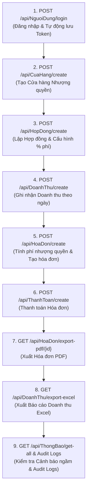

# QUY TRÌNH KIỂM THỬ TỰ ĐỘNG BẰNG POSTMAN (POSTMAN WORKFLOW)
**Dự án**: Quản lý chuỗi cửa hàng nhượng quyền (Franchise)  
**File Collection**: `BTL_CuaHangNhuongQuyen.postman_collection.json`  

---

## 1. TỔNG QUAN LUỒNG KIỂM THỬ (TEST FLOW)

Sơ đồ thể hiện quy trình kiểm thử End-to-End (E2E) từ khi đăng nhập đến khi tạo hóa đơn và xuất báo cáo:



---

## 2. BẢNG MÔ TẢ CÁC BƯỚC TEST CHI TIẾT

| Bước | Tên Request | Method & Endpoint | Mô tả & Mục đích |
| :---: | :--- | :--- | :--- |
| **1.1** | **Đăng nhập Admin** | `POST /api/NguoiDung/login` | Đăng nhập tài khoản `admin@franchise.local` / `123456`. Script tự động trích xuất `token` và gán vào biến `{{bearer_token}}` cho tất cả các request tiếp theo. |
| **1.2** | **Đăng ký tài khoản** | `POST /api/NguoiDung/register` | Đăng ký thêm tài khoản Chủ cửa hàng mới (`vaitroid = 2`). |
| **2.1** | **Tạo Cửa hàng** | `POST /api/CuaHang/create` | Tạo mới một cửa hàng nhượng quyền (mã `CH_CAU_GIAY_01`). |
| **2.2** | **Lấy danh sách cửa hàng** | `GET /api/CuaHang/get-all` | Kiểm tra danh sách các cửa hàng đã tạo trong hệ thống. |
| **3.1** | **Tạo Hợp đồng** | `POST /api/HopDong/create` | Lập hợp đồng nhượng quyền cho cửa hàng với mức phí `%` (ví dụ `5%`), thời hạn từ `2026-01-01` đến `2028-12-31`. |
| **3.2** | **Danh sách Hợp đồng** | `GET /api/HopDong/get-all` | Kiểm tra trạng thái hiệu lực và version (`phienban`) của hợp đồng. |
| **4.1** | **Khai báo Doanh thu** | `POST /api/DoanhThu/create` | Chủ cửa hàng nhập doanh thu bán hàng theo ngày (`15,500,000 VNĐ`). |
| **4.2** | **Xuất Excel Doanh thu** | `GET /api/DoanhThu/export-excel` | Tải về file `.xlsx` báo cáo doanh thu toàn hệ thống (`ClosedXML`). |
| **5.1** | **Tạo Hóa đơn Franchise** | `POST /api/HoaDon/create` | Hệ thống tự động tính tiền phí nhượng quyền (`5%` * Doanh thu) + Thuế VAT (`10%`) để phát hành hóa đơn kỳ `2026-10`. |
| **5.2** | **Xuất Hóa đơn PDF** | `GET /api/HoaDon/export-pdf/1` | Tải về file PDF hóa đơn tài chính chuẩn mẫu qua `QuestPDF`. |
| **5.3** | **Thanh toán Hóa đơn** | `POST /api/ThanhToan/create` | Ghi nhận giao dịch chuyển khoản thanh toán cho hóa đơn. |
| **6.1** | **Cảnh báo ngầm In-App** | `GET /api/ThongBao/get-all` | Kiểm tra danh sách thông báo do `HopDongExpirationBackgroundService` quét tự động. |
| **6.2** | **Nhật ký Thao tác (Audit)**| `GET /api/LichSuThaoTac/get-all` | Lấy lịch sử vết thao tác hệ thống (AI làm gì, lúc nào). |

---

## 3. HƯỚNG DẪN THỰC THI KIỂM THỬ TRÊN POSTMAN

### Bước 1: Khởi động Web API
Mở Visual Studio hoặc chạy lệnh terminal trong thư mục dự án:
```powershell
dotnet run --project btl_CuaHangNhuongQuyenADMIN
```
*(Mặc định API Admin sẽ chạy tại port: `http://localhost:5160`)*

### Bước 2: Import Collection vào Postman
1. Mở ứng dụng **Postman**.
2. Nhấn nút **Import** ở góc trên bên trái.
3. Chọn file `BTL_CuaHangNhuongQuyen.postman_collection.json` tại thư mục dự án.

### Bước 3: Chạy Kiểm thử Tự Động (Run Collection)
1. Nhấp chuột phải vào Collection **`BTL_CuaHangNhuongQuyen_Postman_Workflow`**.
2. Chọn **Run collection**.
3. Nhấn **Run BTL_CuaHangNhuongQuyen_Postman_Workflow**.
4. Postman sẽ lần lượt gửi toàn bộ request theo đúng thứ tự nghiệp vụ và hiển thị kết quả kiểm thử xanh (`200 OK / Passed`).
